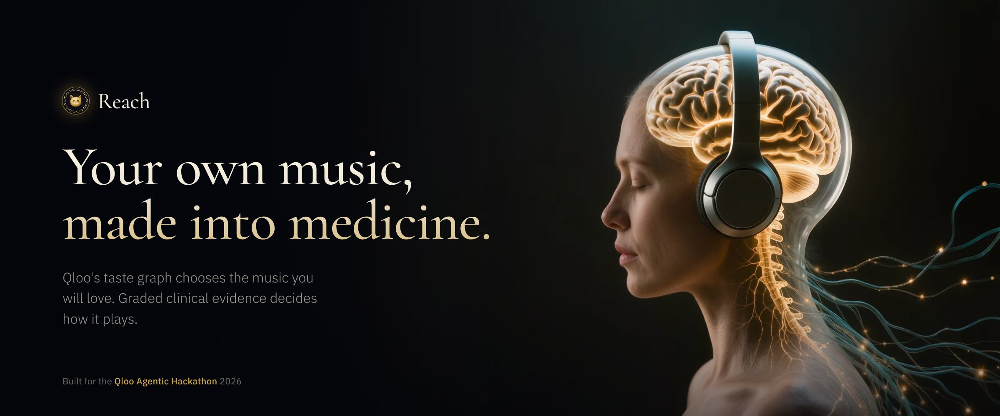
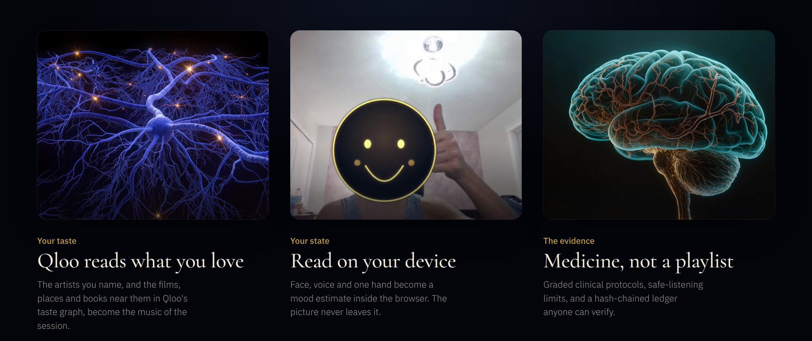
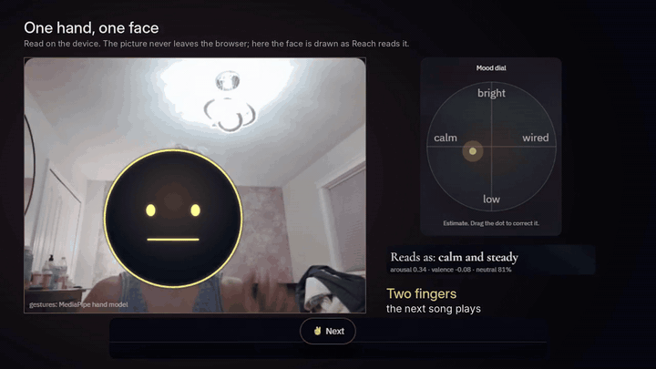
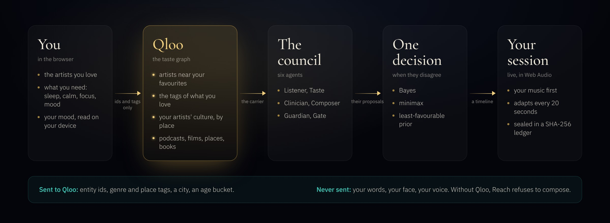
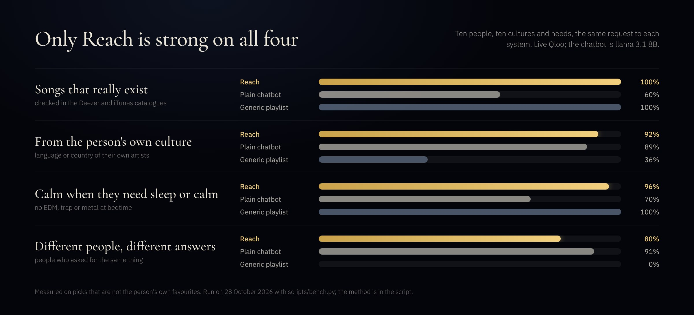

<p align="center">
  
</p>

<p align="center">
  <b>Reach</b> builds a therapeutic sound session out of the music a person already loves.<br>
  <b>Qloo</b>'s taste graph chooses every artist, a council of agents chooses the evidence-graded protocol,<br>
  and the browser plays it live, adapting to their mood. Without Qloo, Reach refuses to compose.
</p>

<p align="center">
  <a href="#run-it-in-a-minute"><b>Run it</b></a>&emsp;&emsp;<a href="#how-qloo-is-used"><b>How Qloo is used</b></a>&emsp;&emsp;<a href="#one-hand-one-face"><b>See it read a face</b></a>&emsp;&emsp;<a href="JUDGE.md"><b>For judges</b></a>&emsp;&emsp;<a href="web/privacy.html"><b>Privacy</b></a>
</p>

<!-- contents -->

## Three things, one session

<p align="center"></p>

Music that fits you is medicine that gets taken. Reach starts from the artists you name, reads how you are on your own device, and plays a session whose tempo, key, pulse and volume follow a graded clinical protocol: sleep, calm, focus, mood, memory, energy, sensory-safe sessions for autistic children, and 40 Hz support. Every step is written to a hash chain you can verify.

## One hand, one face

<p align="center"></p>

<p align="center"><sub>From the guided tour, filmed in the real app. Two fingers play the next song, a thumb up is remembered, a thumb down changes it, and a smile moves the mood dial to bright. The face is drawn over; the camera picture never leaves the browser.</sub></p>

## How a session is made

<p align="center"></p>

Your favourites become Qloo entity ids. Qloo returns the artists, tags, places and stories near them, and that taste becomes the *carrier* of the session: which artists, what texture, which instrument palette. Six agents then propose: the **Listener** reads the need and the mood, **Taste** speaks for Qloo, the **Clinician** weighs graded protocols against hearing, age and contraindications, the **Composer** writes the timeline, the **Guardian** caps the volume, and the **Gate** recommends only when the evidence holds. When they disagree, three decision rules vote. The browser plays the result and adapts every twenty seconds.

## Who it's for

* **A grandmother in memory care** who grew up with Hayedeh: her own songs first, then the singers Qloo links to them in her culture, and a Persian kitchen near her for the family afterwards. Music-based therapy probably improves depressive symptoms in dementia ([Cochrane 2025](https://www.cochrane.org/about-us/news/music-based-therapy-may-improve-depressive-symptoms-people-dementia), 30 studies, 1,720 people).
* **Lena, 7, autistic**, overwhelmed after school: *Thomas & Friends* and *Bluey* at the core of a sensory-safe session, a steady pulse, no surprises, a lower volume cap.
* **Daniel, 34, deaf since birth**, awake at 1 a.m.: Reach refuses him an auditory session and says why, then breathes with him in light and vibration, with films Qloo picks from his taste.
* **Mateo, 24, who has Down syndrome** and speaks Spanish: Bad Bunny and Shakira carry a focus session before speech therapy, in Spanish.

One agent for all of them, and for a room of them together: the session is chosen to be fair to everyone in it.

## How Qloo is used

| Call | Why |
|---|---|
| `/v2/insights` `filter.type=urn:entity:artist` + `signal.interests.entities` (favourites) + `signal.interests.tags` (genres the person named, e.g. techno) + `filter.tags` (protocol genres, union) + `filter.exclude.tags` | the carrier playlist that fits the protocol's texture |
| `/v2/insights` `filter.type=urn:entity:artist` + `signal.location.query` (a city) | the world tour: what a place loves |
| `/v2/insights` `filter.type=urn:entity:artist` + favourites + `signal.location.query` (where your artists come from, from MusicBrainz) | the cultural candidate pool for the ranking step |
| `/v2/insights` `filter.type=urn:entity:podcast` + favourites + the same location | podcasts listeners with your taste follow in your artists' culture |
| same, unfiltered | fallback carrier and the texture profile |
| `filter.type=urn:tag` + `filter.tag.types` | the music tags attached to what the person loves → instrument palette, mood and tempo bias |
| `filter.type=urn:demographics` | cultural lens of the favourites' audience |
| `filter.type=urn:entity:podcast` | podcasts the person would like, resolved to episodes through iTunes/RSS |
| `filter.type=urn:entity:movie` / `tv_show` + `filter.content_rating` | the visual carrier for people who cannot hear |
| per-member insights + Bayes / minimax / least-favourable prior | group sessions |
| `/v2/insights` `filter.type=urn:entity:place` + favourites + `filter.location.query` (your city) + `filter.tags` (`urn:tag:category:place:park`, `library`, `museum`, `persian_restaurant`…, union) + explainability | After the music: places and tables near you; each result re-checked against its own category tags, drinking venues dropped |
| `/v2/insights` `filter.type=urn:entity:book` + favourites | After the music: a book from the same taste |
| `/search` | resolving a favourite's name to an entity id (server side); genre words become tags, albums and people are never offered as favourites |

**Sent to Qloo:** entity ids, genre and place-category tag ids, a city, an age bucket. **Never:** the request text, the mood, the face or the voice.

Previews are 30 seconds because that is what the open catalogues licence; every track card links to the full recording. Soundscapes and podcasts play full length.

## With Qloo, and without

* **In the app**, Clinic chapter, *Without Qloo*: the list any model hands everyone for the same need, next to the carrier Qloo built for this person, both scored by Qloo affinity to *this* person.
* **On ten people** from ten cultures, `scripts/bench.py` puts a generic playlist, a plain chatbot and Reach side by side, with live Qloo:

<p align="center"></p>

The plain chatbot invents: four in ten of its songs could not be found in any catalogue, including every one of its Persian sleep songs. The generic playlist is real and calm, but it hands everyone the same list, from someone else's culture. Reach is the only one strong on all four. On Qloo taste fit Reach scores 0.76 against the chatbot's 0.37, a measure that favours Reach by construction, so we show it here rather than in the chart. The same numbers are on `/judge`.

## Who pays for it

Memory-care homes and hospitals, per bed: the care-team view, graded evidence and a verifiable ledger, with no patient database to secure (57 million people live with dementia, [WHO](https://who.int/initiatives/decade-of-healthy-ageing/cross-cutting-issues/dementia)). Music therapists, between visits. Sleep, wellness and assistant apps, per session through the API and MCP. People at home, free at the core. One container, no accounts, no database: the main cost of a session is its Qloo calls.

## Run it in a minute

```bash
pip install -r requirements.txt
export QLOO_API_KEY=...            # server side only; never in the browser
python -m uvicorn server.app:app --port 8000
# open http://localhost:8000
```

On Windows PowerShell: `$env:PYTHONUTF8="1"; $env:QLOO_API_KEY="..."; python -m uvicorn server.app:app --port 8001`. Keys can also live in a local `.env` file (git-ignored), which the server reads at start.

* **Without a key**: `REACH_OFFLINE=1 python -m uvicorn server.app:app --port 8000` plays recorded Qloo answers.
* **Tests**: `python -m unittest discover -s tests` runs 54 offline checks of the council, the parsers, the ledger and the tour.
* **Deploy**: on Render, connect the repo (`render.yaml` is picked up) and set `QLOO_API_KEY`. Fly.io and Docker work too; see *On your phone, and deploying* below.

Then press **Guided tour** at the top right: a four-minute walkthrough, spoken in a natural voice and captioned, in the interface language.

## What is inside

<details markdown="1">
<summary><b>The start page, the guided tour, frequencies and fourteen languages</b></summary>

**First screen** (`web/universe.js`): a listener in headphones, her brain lit, and around her eight worlds, one for each thing Reach does: your music, frequencies, your face and mood, one-hand gestures, a mode without sound, After the music, fourteen languages, and the care team's evidence and ledger. Light flows from her into every world. Click a world and the camera flies to it, a short clip of the real app plays, and one button opens that part of the app; the frequency world is an instrument you can play right there. **Start my session** opens a drawer with four choices: what you love, what you need (one, or two for a journey such as calm, then sleep), who is listening (a row per person: a name and who they love, looked up in Qloo), and where you are (📍 optional, rounded to about 1 km, never stored). The film introduction is one click away. [Privacy](web/privacy.html) is at `/privacy`, and this README at `/readme`.

**Guided tour**: a spoken walkthrough in a natural neural voice (Kokoro "Heart", recorded offline with `scripts/make_voice.py`; English, Spanish and Chinese, Persian as captions). Press *Guided tour* (top right of the start page and of the app) for a spoken, captioned four-minute walkthrough of the Studio, the council and how Qloo is used, in the interface language. While it speaks, every other sound in the app waits. `?tour=1` opens it directly. `scripts/make_guide_video.py` renders the same tour as a narrated video (`docs/reach-guided-tour-<lang>.mp4`).

**Frequencies**: a tab of its own (`web/instrument.js`). Five bands (2, 6, 10, 16, 40 Hz), each drawing its own Chladni figure in sand on a 3D plate; speakers (an isochronic pulse) or headphones (a binaural beat); a low, middle or high pitch; an optional soft pad; volume capped below the session's −14 dBFS. Each band states its evidence grade; entrainment is labelled experimental. The plate never flashes at the pulse rate.

**Fourteen languages**: English, Spanish, Persian, Chinese, Arabic, French, German, Italian, Portuguese, Turkish, Hindi, Japanese, Korean and Russian, with Persian and Arabic right to left. The ten newest load only when someone picks one (`web/i18n_more.js`).

**For judges**: `/judge` on the running server is a one-page brief: a button that runs a real session and lists every Qloo call it made with the hash-chained ledger (verify it on the server), the comparison with a plain chatbot, what is and isn't sent to Qloo, and where each judging criterion shows. [JUDGE.md](JUDGE.md) is the same in text.

</details>

<details markdown="1">
<summary><b>What you can do in the Studio</b></summary>

The Studio has five tabs: **Talk** (the conversation, the session and the 3D stage), **About me** (who you are, what you love, the people with you), **How I feel** (camera preview, voice, hands, the mood dial, goals), **Watch & breathe** (the visual session: breathing light, vibration, a calm 4K film and trailers of films and shows from your taste, captions on) and **After the music** (one gentle next step near your city: a place, a table and a book, from the same taste). The **World tour** is its own chapter after the Studio.

* **Onboard as yourself**: name, age, city, hearing, and what you love. The search autocompletes from Qloo's entities and from Deezer/iTunes artists worldwide, so Hayedeh, Pitbull or Joe Hisaishi all resolve.
* **Talk to it like a person**: a conversation agent (`reach/dialogue.py`) reads every message against what is playing right now and does what the message needs. "I said Hayedeh, why another singer?" plays Hayedeh and says honestly who was playing and why. "Only Dariush", "my favourites", "not this one", "no more Kalben, play Googoosh", "podcasts about history", "rain sounds", "just the frequencies" and "is it safe?" all work this way. Only a real new need ("I'm sleepy", "slower", "no vocals") asks the council for a new session. Rules run in four languages, Persian-script names included (هایده is Hayedeh). With a language model the agent also understands free speech: Ollama on your own machine (`OLLAMA_URL`, `OLLAMA_MODEL`, default `llama3.2`, so your words stay on your computer), or `ANTHROPIC_API_KEY` / `OPENAI_API_KEY`. Its answer may use only the facts it was handed. `REACH_LLM=off` turns the model off.
* **Your own artists first**: the playlist opens with the artists you named (the one you just asked for leads), then Qloo's picks, ranked for you as described in *How the music is chosen*.
* **Group session**: "I'm with three friends, one likes Indian music, one wants no vocals" or add people by name. Each person is read through Qloo; the carrier is chosen by Bayes, minimax and the least-favourable prior over the people in the room.
* **Carrier**: your artists (previews from Deezer/iTunes, played one after another without gaps, each with a link to the full track), full-length soundscapes (Internet Archive, speech filtered out), podcasts Qloo thinks you'd like (up to six, iTunes + RSS), generated only, or **visual + haptic** (breathing light, phone vibration at tempo, films and shows from your taste) for deaf users; set hearing to *deaf* and the council routes to the visual protocol by itself.
* **Frequencies are their own session**: songs, soundscapes and podcasts play clean, with no pulse on them. The pulse plays under *Frequencies*, and each band says what it is for: delta sleep, theta meditation, alpha calm and nerves, beta focus, gamma memory. Click a band to hear it.
* **Soundscapes are real recordings with no voices** (campfire, waves, rain, rain on a window, thunder, birds, river, waterfall, wind in trees, crickets, singing bowl, whale), looping, shipped in `web/assets/scapes` (from the open-source Moodist project, Pixabay/CC0; see `web/assets/scapes/CREDITS.md`).
* **Full songs**: with `YOUTUBE_API_KEY` set on the server, *Your artists* plays each song in full as a small music video (found once, cached in `data/yt_cache.json`); without it, 30-second previews with a notice before each change.
* **Push to talk**: tap 🎤 by the chat box and say "I'm sleepy, play something to help me sleep". Reach listens only while you talk, and the music ducks so it hears you and not its own songs or podcasts. The tone of your voice is read only then, and only if you allowed it. Replies come as one plain message. The agents' full reasoning is under *Why this session*.
* **Generated layer** (off by default): under any recording sits the generated pad, pulse and air; switch it off for the song alone or set its level. The pulse touches a recording at 40 % of its depth, never as a tremolo over the music.
* **Live pulse**: drag the pulse or click a band to hold a frequency with its explanation; "Follow session" releases it. Intensity and demo speed ×10 for judges.
* **Mood changes earn a question**: when the reading changes and holds for two adaptations (40 s), the Listener asks *keep what's playing, smoother, or more energetic?* before anything switches. "Tired, need a boost" goes to the **Energise** protocol (techno / house / dance carrier through Qloo's genre tags).
* **Face, voice, hands**: on-device face expressions (face-api.js), voice prosody, and hand gestures from MediaPipe's pretrained gesture recognizer (GPU, falling back to CPU). Only if the model cannot load at all does Reach use the author's own skin-colour tracker (`web/vendor/tracker.js`). A small live window shows your hand, its 21 landmarks, the gesture read and a hold meter. Open palm held still = play/pause, ✌ two fingers = next, fist = pause, 👍 = more like this, 👎 = not this.
* **The plate**: the 3D Chladni plate under the Hz number. Light gathers on the nodal lines, so every band draws its own figure in its own colour: delta wide rings, gamma a fine lattice. It morphs when the frequency changes and breathes with the beat. *⤢ Plate* opens it full screen: tap a band to hear its frequency alone and watch the figure form.
* **Podcasts as a choice**: a row of shows picked for you, each with its reason: about an artist you love, in your artists' culture, what Qloo says listeners with your taste follow there, or for what you need now. Tap one; Next moves to another show; shows you heard recently go to the back.
* **What the world loves** (World chapter, after the Studio): the globe turns to the country and outlines it in red, dives in, and becomes a map with the country filled by the city's streets (Wikipedia photos) and a pulsing pin. Then the city itself: the author's video vibe for the place (`data/tour_media.json`, YouTube links matched to cities by title, each with the segment to show; add more with *+ video*) or its street photos with a classic of the country (Googoosh for Tehran, Modugno for Rome, Piaf for Paris), and what the city loves now through Qloo's location signal. Then back to orbit for the next country. Drop from orbit to Rome, Paris, Istanbul, Tehran, Mumbai, Lagos, Rio, Seoul, Tokyo, Mexico City, Cairo, Berlin, Havana or Madrid; Qloo's location signal names the artists the city loves, a preview plays, the chapter rises back to orbit. Or let the tour run.
* **Colour**: the Studio takes the colour of the session's goal and the cover art of what is playing.
* **After the music**: when a session ends Reach offers one gentle next step, not more audio. A 3D night map of your city puts Reach at the centre and raises a column of light for each place Qloo suggests, at its real bearing and distance, as tall as its affinity; light flows to it along an arc. *A place* is the kind of place that suits what the session was for (a park or botanical garden after a calm session, a library after focus, a museum or record store after memories; after a sleep session it is for tomorrow morning, because daylight sets the body clock). *A table* is where people with your favourites eat near you; after a memory session, the kitchen of the songs (Persian restaurants for Hayedeh). *A page* is a book from the same taste, on a small lit shelf. Every card says which favourite it is close to (Qloo explainability). Bars, clubs, breweries and the like are never suggested; for children, no live-music venues. Sent: favourites' ids, place category tags, your city.
* **For clinics**: patients, their sessions and feedback, the without-Qloo comparison (generic list vs the carrier, scored by affinity to the person), ledger verification, evidence and rules.

</details>

<details markdown="1">
<summary><b>How the music is chosen</b></summary>

The design follows how large recommenders work, adapted to a person's culture:

1. **Candidates, then ranking** ([Covington et al., RecSys 2016](https://research.google/pubs/pub45530/)). Qloo generates the candidates in three ways: its general picks for your favourites, picks fitted to the protocol's texture, and picks from its location signal pointed at your artists' home.
2. **Culture is measured, never listed.** No table of cultures or countries is written anywhere in the code. Each artist gets two signals from open data:
   - where they come from (MusicBrainz country and city, resolved through its area relations);
   - the language their releases are written in (MusicBrainz).

   A third signal is the language of their own song titles: a character n-gram fingerprint weighted by TF-IDF over the artists in the session, the way language identifiers such as [CLD3](https://github.com/google/cld3) work. Hangul, Han, kana, Persian letters, Turkish ı ğ ş and Spanish ñ separate themselves.

   The research behind this:
   - listening is increasingly local, and shared language and geography predict it ([Way et al., ICWSM 2020](https://ojs.aaai.org/index.php/ICWSM/article/view/7336));
   - a country code alone is a weak proxy for culture ([Zangerle et al., UMAP 2018](https://dbis-web1.uibk.ac.at/sites/default/files/2018-07/umap_culture_zangerle18.pdf));
   - culture is also language ([Schedl et al., 2018](https://arxiv.org/abs/1710.03208)).
3. **Slots follow your own mix.** Three Persian favourites and one American give six Persian picks and two American ones. A candidate from a culture none of your artists share is set aside when most of your favourites are in one culture, and Reach tells you so. Say "something different" and it explores instead.

   The same code serves every culture: Jay Chou and JJ Lin bring Mandopop (Taiwan and Singapore share Mandarin), Mexican and Colombian singers share Spanish, and BTS or Utada Hikaru stay out for a Mandopop listener.

   Generalists, whose favourites are spread across cultures, get more variety, because diversity matters most for them ([Anderson et al., WWW 2020](https://www.cs.utoronto.ca/~ashton/pubs/alg-effects-spotify-www2020.pdf)).
4. **What you finish counts.** Watch time drives YouTube's ranking. Here, songs you play to the end raise an artist, early skips lower it, and an artist skipped again and again drops out (implicit feedback in the sense of [Hu, Koren & Volinsky 2008](https://dparra.sitios.ing.uc.cl/classes/recsys-2016-2/clase10_implicit-feedback.pdf)).
5. **Diversity re-rank.** Maximal marginal relevance ([Carbonell & Goldstein 1998](https://arxiv.org/pdf/2212.14464)) keeps one sound from taking over the list.

</details>

<details markdown="1">
<summary><b>Inside your assistant (MCP)</b></summary>

Reach is an MCP server at `https://<your server>/mcp` (Streamable HTTP, JSON-RPC 2.0, `reach/mcp.py`). Add it to Claude (Settings, Connectors, Add custom connector) or ChatGPT (Settings, Connectors, developer mode) and say "I can't sleep, I love Hayedeh". Tools:

| Tool | What it returns |
|---|---|
| `compose_session` | favourites + need → the full council: own artists first, Qloo's picks with which favourite each is close to, tempo path, pulse band, volume cap, evidence grades with sources, Qloo call count, ledger head, and a link that opens it in the app |
| `after_the_music` | a place, a table and a book near their city from Qloo (never a bar) |
| `explain_evidence` | the protocols for a need with graded evidence and sources |
| `reach_vs_chatbot` | the last measured comparison |

</details>

<details markdown="1">
<summary><b>Against a plain chatbot</b></summary>

`python scripts/bench.py` (needs the Qloo key; includes a language model when Ollama runs locally or an Anthropic/OpenAI key is set) gives the same ten people (Persian, Mandarin, Afrobeats, K-pop, Turkish, Bollywood, Mexican, techno, a Shakira + Aznavour mix, and lively favourites who need sleep) to three systems: a generic calm/sleep playlist, a language model asked directly for eight songs, and Reach. It measures, on picks that are not the person's own favourites: picks from the person's culture (MusicBrainz language or country), picks that are real and playable (found in the Deezer/iTunes catalogue), calm picks for sleep and calm, different answers for different people who asked the same thing, and Qloo taste fit (which favours Reach by construction, and says so). It writes `data/bench_results.json` (aggregate numbers only) which `/judge` shows.

</details>

<details markdown="1">
<summary><b>The council, file by file</b></summary>

`reach/mood.py` Listener · `reach/taste.py` Taste (Qloo) · `reach/agent.py` Clinician, Guardian, Gate · `reach/decision.py` Bayes / minimax / least-favourable prior (multiplicative weights), BLUE pooling, policy gate · `reach/composer.py` Composer and ISO-principle adaptation · `reach/ledger.py` hash chain · `reach/narrator.py` number-grounded explanation · `data/protocols.json` evidence registry with grades and sources.

Browser: `web/film.js` (three.js stage: human, neurons, genome, Earth, galaxy) · `web/universe.js` (the start page) · `web/synth.js` (generative session player, WebAudio) · `web/mood.js` (face-api.js expressions + voice prosody, on device) · `web/guide.js` (the guided tour).

Checks from your machine: `python scripts/selfcheck.py` (every outside source, incl. Qloo's location signal), `python scripts/record_fixtures.py` (records Qloo responses so the demo runs offline), `python scripts/make_guide_video.py --url http://localhost:8001 --lang en` (narrated tour video; `pip install playwright edge-tts imageio-ffmpeg && python -m playwright install chromium`).

Optional: `ANTHROPIC_API_KEY=...` lets a language model rephrase the explanation; every number it writes is checked against the fact sheet, and the template is used if any number is not grounded.

</details>

<details markdown="1">
<summary><b>On your phone, and deploying</b></summary>

Reach is a Progressive Web App: a manifest, icons and a service worker, so it installs to the home screen and opens full-screen, with bottom tabs on phones. It needs HTTPS for install, the camera and the microphone:

* **Today, from your PC**: run the server, then `cloudflared tunnel --url http://localhost:8001` (install once: `winget install Cloudflare.cloudflared`). Open the `https://….trycloudflare.com` address on the phone, then *Install app* (Android, Chrome menu) or *Share → Add to Home Screen* (iPhone, Safari). It works while the PC and the tunnel run.
* **Always on**: deploy and install from the hosted address.
* Same Wi-Fi without HTTPS (`--host 0.0.0.0`, open `http://<PC address>:8001`) works in the browser, but phones block the camera and microphone there.

Home-screen shortcuts: *Help me sleep*, *Watch & breathe*, *World tour*. The logo is `web/icons/reach-logo.svg`.

**Render** (one click): connect the repo, `render.yaml` is picked up, set `QLOO_API_KEY` in the dashboard.
**Fly.io**: `fly launch --copy-config --yes && fly secrets set QLOO_API_KEY=... && fly deploy`.
**Docker anywhere**: `docker build -t reach . && docker run -p 8000:8000 -e QLOO_API_KEY=... reach`.

</details>

## Evidence and honesty

Grades are in `data/protocols.json` with sources. The A-grade claims are music for stress and anxiety, music for subjective sleep quality, therapist-delivered music therapy in autism, and paced breathing. Entrainment (binaural, isochronic, 40 Hz for wellness) is labelled experimental (C/D). Music and gene activity: one session can transiently shift blood gene activity in small samples (Kanduri 2015); nothing here claims to modify DNA.

Safety: WHO-ITU safe-listening levels (80 dB adults, 75 dB children), output capped at −14 dBFS (−20 for children and sensory-safe sessions), pulse depth capped, not for driving. Audio pulses are not photic flicker. Reach is a wellbeing tool, not a medical device.

## Licence and credits

MIT. Earth textures from three.js (MIT). face-api.js (MIT). Soundscapes from the Moodist project (Pixabay/CC0). The start-page music (Bach, Prelude in C) is public domain, rendered for Reach. The portrait, brain and neuron images and the touch film were made with Kling AI for Reach. The hand-and-face film is the author's own, with the face drawn over.

<p align="center"><sub>Built for the Qloo Agentic Hackathon 2026.</sub></p>
